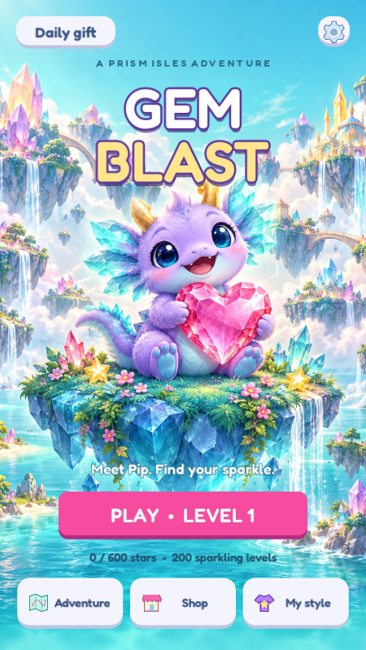

# Gem Blast — Prism Isles

An original, offline, portrait match-3 adventure made in **Godot 4.6.3**. Explore ten crystal islands with Pip, a cheerful little crystal dragon, through 200 levels.



## Open and play

1. Download this repository (**Code → Download ZIP**) and extract it.
2. Install the standard **Godot 4.6.3** editor (the .NET edition is unnecessary).
3. In Godot's Project Manager choose **Import**, select `project.godot`, and let the assets import.
4. Press **F5**. The splash screen leads to the main menu.

No add-ons, package manager, account, server, payment keys, or additional assets are required. The project runs on desktop for convenient testing and is configured for portrait mobile play. The Compatibility renderer keeps the graphics requirements modest.

**Controls:** drag between neighboring gems, or tap/click one gem and then its neighbor. Invalid swaps return the gems without consuming a move. Escape / Android Back opens the pause menu when the board is idle.

## Included

- Original illustrated island artwork and Pip, six individually recognizable gem shapes, vector icons, a bundled rounded font, synthesized music, and sound effects.
- Animated swaps, gravity, cascading matches, particle sparkles, hints, and automatic refresh when no move remains.
- Four-gem line blasts, five-gem Prisms, T/L burst gems, and chained special combinations.
- **200 separate editable level Resources**, ten chapters, score/collection/ice/stone objectives, board masks, and recurring crown challenges.
- Splash, home, level map, level briefing, gameplay, pause, victory, retry, settings, shop, and customization screens.
- Persistent unlocks, best scores, 1–3-star ratings, coins, boosters, cosmetics, settings, and a daily gift.
- Three coin-purchased boosters and three cosmetic palettes. Replays only award coins for newly improved stars.
- A coin-pack entry marked **Coming soon**. **Real payments and advertisements are not implemented**; no purchase claims or charges are made.

The standard campaign has no lives timer. Leaving a level discards the current attempt; completed progress is saved. Current-level resumption and cloud saves are not implemented.

## Edit in Godot

Open `scenes/main.tscn` for the application. Individual screens are real, editable `.tscn` scenes in `scenes/ui/`; the board and gem components are in `scenes/game/`.

Select any `resources/levels/level_001.tres` through `level_200.tres` in the FileSystem dock to edit its exported values in the Inspector. Goals, move budgets, colors, blockers, board masks, and seeds are independent per level. Cell indices are row-major, 0–63, on an 8×8 board. Keep ice, stones, and holes disjoint and retain room for legal matches.

`resources/themes/game_theme.tres` holds the shared font, colors, and dimensional button states. See [architecture](docs/ARCHITECTURE.md), [level design](docs/LEVEL_DESIGN.md), [mobile export](docs/MOBILE.md), and [asset credits](docs/CREDITS.md).

## Tests

From the project folder, with Godot available as `godot`:

```sh
godot --headless --editor --import --quit
godot --headless --path . --script tests/test_core.gd
godot --headless --path . --script tests/test_ui.gd
```

`tests/test_save.gd` intentionally changes the save. Run it in a **separate user-data directory**; the provided Linux runner handles this automatically:

```sh
bash tools/test.sh
```

The suite covers all 200 level starts and 1,600 simulated turns, special gems, invalid swaps, gravity, goals, screen transitions, booster spending, rewards, retry/continuation, and backup recovery. See [validation results](docs/VALIDATION.md) for scope and remaining device checks.

Optional campaign analysis: `godot --headless --path . --script tests/balance_campaign.gd`. This is a one-step greedy bot, not a human difficulty guarantee. Optional rendered screenshots: `godot --path . --script tests/capture_screens.gd` (requires a graphical display).

## Save data

Progress is stored in Godot's `user://progress.json`, with an atomic temporary write and a previous-save backup. In Godot, **Project → Open User Data Folder** opens this directory. Back up your save before deleting both `progress.json` and `progress.json.bak` to start over.

This is a playable first release, with automated campaign checks. Human playtesting and real Android/iOS device testing are still needed for production balancing and release certification.
